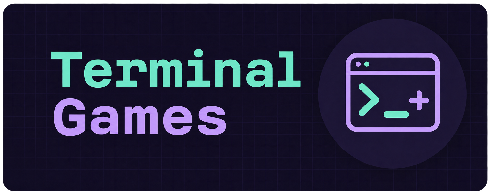
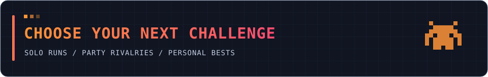
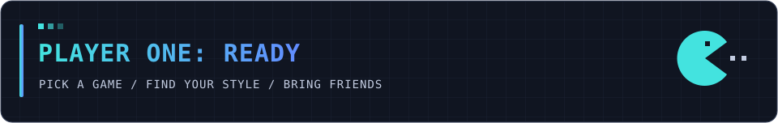
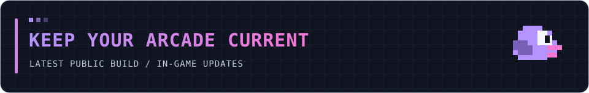
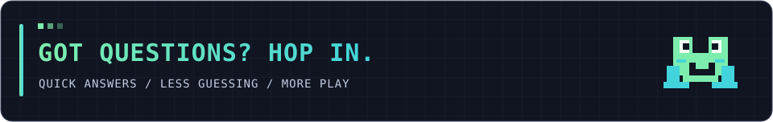
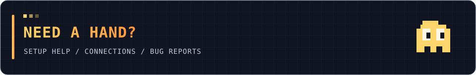

<div align="center">

**Connection error after the outage?** Use the [one-time connection repair](repair/README.md)—no reinstall or new account required.



# Your terminal. Your arcade.

**Quick games. Friendly rivalries. One more round.**

Classic-style games, multiplayer parties, and a little more hiding behind the menus.

[](https://github.com/Doyboy1005152/TerminalGames/releases/tag/Release)

[](https://discord.gg/nnVcGzDpCY)

**[Windows](./install-windows.bat?raw=true) · [macOS](./install-mac.command?raw=true) · [Linux](./install-linux.sh?raw=true)**

[Get started](#get-started) · [Watch the trailer](#game-trailer) · [What's inside?](#whats-inside) · [FAQ](#faq) · [Get help](#need-a-hand)

</div>

---

### Play. Compete. Make it yours.

**Pick up & play** — Arcade classics, quick challenges, and personal bests worth chasing.

**Bring your rivals** — Party up, race friends, and climb the leaderboards.

**Find your style** — Unlock cosmetics, change your colors, and discover hidden surprises.

## Get started

**Choose your platform. Download one installer. Follow the prompts.**

### [↓ Windows](./install-windows.bat?raw=true)　·　[↓ macOS](./install-mac.command?raw=true)　·　[↓ Linux](./install-linux.sh?raw=true)

Each installer fetches the **latest public version**. No source-code download or ZIP extraction is needed.

<details>
<summary><strong>Windows setup</strong></summary>

1. Download **install-windows.bat** above.
2. Open it and follow the prompts to install and launch Terminal Games.

</details>

<details>
<summary><strong>macOS setup</strong></summary>

1. Download **install-mac.command** above.
2. Open it and follow the prompts to install and launch Terminal Games.

</details>

<details>
<summary><strong>Linux setup</strong></summary>

1. Download **install-linux.sh** above.
2. Open a terminal in your downloads folder and run:

```sh
sh "install-linux.sh"
```

3. Follow the installer prompts.

</details>

An internet connection is required for the download. Follow any Python setup instructions shown by your installer.

## Game trailer

https://github.com/user-attachments/assets/28d06e87-ea38-48f6-89e5-eed05829fcd4

---

## What's inside?



**A growing collection of games and party modes.** Pick a solo challenge or bring friends along.

<!-- PUBLIC-GAMES:START -->

- **Skribbl** — Draw and guess with 2–4 party members.
- **Capture the Flag** — Available only in party mode.
- **Pong** — Paddle battles against the AI.
- **Flappy Bird** — Dodge pipes and chase your best score.
- **Maze Race** — Find the exit and beat your best time.
- **Tetris** — Stack, clear lines, and race the clock.
- **Space Invaders** — 100 levels of alien fleets and bosses.
- **Crossy Road** — Hop past traffic and ride river logs.
- **Levels** — Jump up platforms and climb to new heights.
- **Pac-Man** — Eat pellets, dodge ghosts, and chase high scores.
- **2v2 Pong** — Team paddle battles with four players.
- **Maze Relay** — Team maze relay for four players.
- **Tetris Race** — Race friends while stacking and clearing lines.
- **Pac-Man Race** — Race friends through pellet-filled mazes.

<!-- PUBLIC-GAMES:END -->

<sub>This list stays in sync with each new public game release.</sub>

## Your first round



**01 · Find your game**  
Open **Games** from the main menu. Every game shows its controls.

**02 · Set your style**  
Visit **Settings** for controls and colors, then explore **Collection / Cosmetics** for your unlocks.

**03 · Make it a rivalry**  
Sign in, invite friends to a party, and see who wins the next round.

## Stay up to date



Use the in-game update controls to get the latest public build. The installers above always fetch the current public release.

<details>
<summary>For developers</summary>

Development builds are separate from public releases. Authorized developers can manage them through **Developer Controls**.

</details>

## FAQ



**Quick answers before your next round.**

<details>
<summary><strong>Which operating systems can I use?</strong></summary>

Terminal Games has installers for **Windows, macOS, and Linux**. Choose the one for your computer under [Get started](#get-started), then follow its Python setup prompts if needed.

</details>

<details>
<summary><strong>Do I need to download the source code or extract a ZIP?</strong></summary>

No. Download just your platform's installer. It fetches the latest public game, installs it, and launches it for you.

</details>

<details>
<summary><strong>Can I play by myself or with friends?</strong></summary>

Both. Pick a solo game from **Games**, or sign in and invite friends to a party. Player counts depend on the game; [What's inside?](#whats-inside) lists the available games and party modes.

</details>

<details>
<summary><strong>Why is the game download so small? Where is the music?</strong></summary>

Bundled music downloads when it is needed instead of being included in the game package. Turning music off removes those downloaded tracks; turning it back on downloads them again as needed. Your imported music is kept separately and is not deleted.

</details>

<details>
<summary><strong>Do I need to download a new installer for every update?</strong></summary>

No. Use the in-game update controls. The installers also fetch the latest public version whenever you run them, so you do not need a separate installer for each game version.

</details>

<details>
<summary><strong>What's the difference between public and development builds?</strong></summary>

The public build is the normal release downloaded by these installers. Development builds are separate previews for authorized developers; changes reach the public build when they are released to main.

</details>

## Need a hand?



<details>
<summary><strong>The display looks cramped</strong></summary>

Enlarge your terminal window. Use the text-size hint in the game to adjust your terminal font size.

</details>

<details>
<summary><strong>The installer won't run</strong></summary>

Check that you downloaded the installer for your operating system, then follow its setup prompts. The platform steps are under **Get started** above.

</details>

<details>
<summary><strong>I can't connect</strong></summary>

Check your internet connection and try again later. Visit the Discord community for help and updates.

</details>

<details>
<summary><strong>I found a bug</strong></summary>

You can also submit an in-game bug report: select **Report a bug** from the main menu.

[Open an issue](https://github.com/Doyboy1005152/TerminalGames/issues) with your operating system, game version, and steps to reproduce it. Screenshots help—leave out passwords and private account information.

</details>

---

<div align="center">

**Ready for one more round?**

[](https://github.com/Doyboy1005152/TerminalGames/releases/tag/Release)

[](https://discord.gg/nnVcGzDpCY)

<sub>Download. Install. Play.</sub>

</div>
