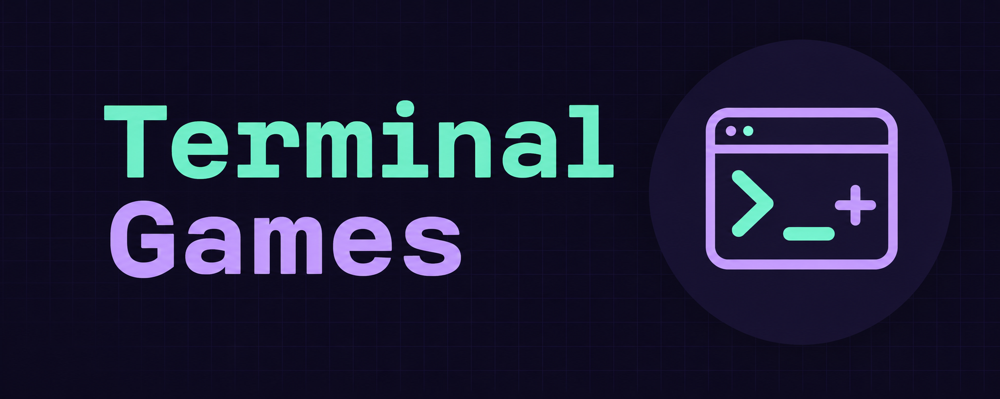
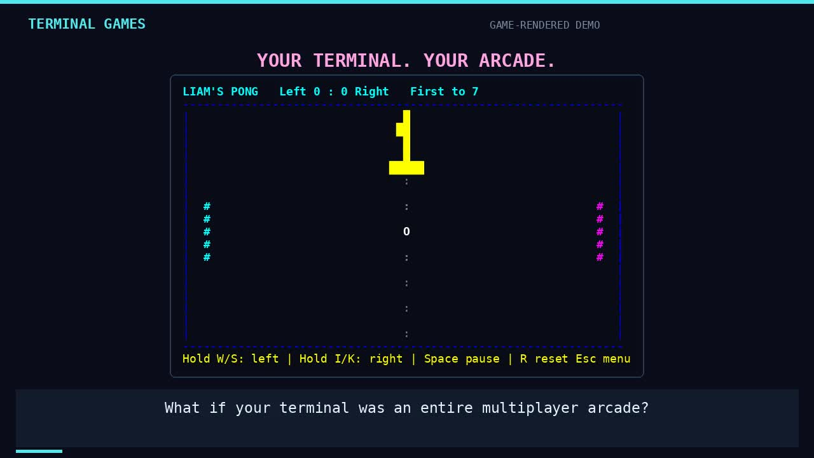

# Terminal Games

**An arcade in your terminal.** Play classic-style games, challenge friends, join parties, and unlock new ways to customize your game.

## Download

[](./terminal-games-installers.zip?raw=true)

**Windows · macOS · Linux**

One ZIP contains installers for all three platforms. Download it, extract it, and run the installer for your computer. The installer downloads the latest public version of Terminal Games.

## Discord

[](https://discord.gg/nnVcGzDpCY)

Find teammates, chat with other players, and follow updates.

## Game trailer

[](https://github.com/Doyboy1005152/TerminalGames/raw/refs/heads/main/media/terminal-games-trailer.mp4)

[Watch or download the trailer](https://github.com/Doyboy1005152/TerminalGames/raw/refs/heads/main/media/terminal-games-trailer.mp4).

## Installation

### Windows

1. Download the installer ZIP above.
2. Right-click the ZIP and select **Extract All**.
3. Open **`install-windows.bat`**.
4. Follow the prompts to install and launch the game.

### macOS

1. Download and extract the installer ZIP.
2. Open **`install-mac.command`**.
3. Follow the prompts to install and launch the game.

### Linux

1. Download and extract the installer ZIP.
2. Open a terminal in the extracted folder.
3. Run:

```sh
sh "install-linux.sh"
```

**An internet connection is required to download the game.** Follow any Python setup instructions shown by the installer.

## What's inside?

<!-- PUBLIC-GAMES:START -->

- **Skribbl** — Draw and guess with 2–4 party members.
- **Capture the Flag** — Only available in party.
- **Pong** — Paddle battles against the AI.
- **Flappy Bird** — Dodge pipes and chase your best score.
- **Maze Race** — Find the exit and beat your best time.
- **Tetris** — Stack, clear lines and race the clock.
- **Space Invaders** — 100 levels of alien fleets and bosses.
- **Crossy Road** — Hop past traffic and ride river logs.
- **Levels** — Jump up platforms and climb to new heights.
- **Pac-Man** — Eat pellets, dodge ghosts and chase high scores.
- **2v2 Pong** — Team paddle battles with four players.
- **Maze Relay** — Team maze relay for four players.
- **Tetris Race** — Race friends while stacking and clearing lines.
- **Pac-Man Race** — Race friends through pellet-filled mazes.

<!-- PUBLIC-GAMES:END -->

Plus multiplayer parties, matchmaking, leaderboards, friends, chat, customizable themes, and hidden secrets to discover.

## Make it yours

Earn cosmetic rewards, choose your theme, and customize your controls. Explore the menus—there may be more to find than you expect.

## Updates

Use the game's update controls to stay current. These installers download the **public release**; development builds are managed separately through Developer Controls for authorized developers.

You don't need to download the project source to play.

## Need help?

- **Display looks cramped?** Enlarge your terminal window.
- **Can't connect?** Check your internet connection and try again later.
- **Installer won't run?** Extract the ZIP first and make sure you're opening the file for your operating system.
- **Found a bug?** Open an issue in this repository with your operating system, game version, and steps to reproduce it. Screenshots help—leave out passwords and private account information.

---

**Download. Install. Play.**
